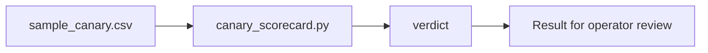

# Traffic Shift Canary Scorecard architecture

Scores canary shifts by error rate, latency, saturation, and rollback readiness.

## Operational boundaries

The documented run evaluates the bundled sample locally. Results depend on the quality and scope of the input. The demo makes no live infrastructure changes.
